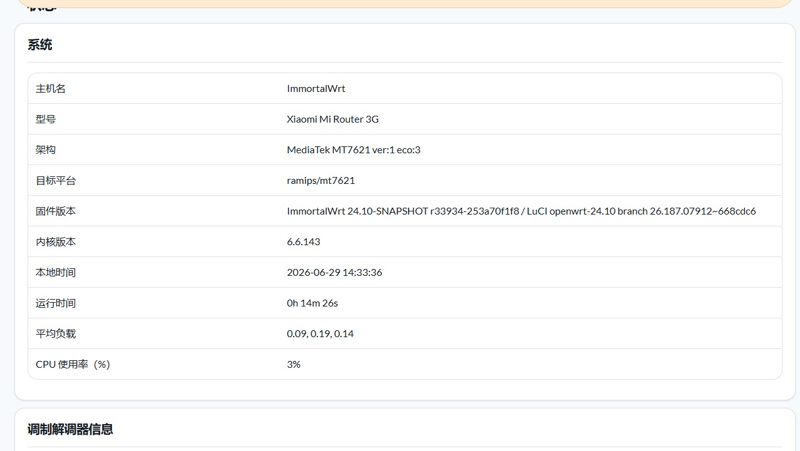

# 基于小米 R3G 的 ImmortalWrt 24.10（6.6 内核）· 带 5G QModem 管理器的自用固件 · bug 未知 蓝色大肥鱼完全自控版本   无测试

本仓库**只放编译配方，不含固件本体**。固件由 GitHub Actions 现场编译并挂到 [Releases](../../releases)。

## 怎么出固件

两种方式，任选其一：

| 方式 | 操作 | 结果 |
| :--- | :--- | :--- |
| 手动 | Actions → `Build ImmortalWrt for Xiaomi R3G` → **Run workflow**（`release_tag` 留空会自动生成 `v24.10-YYYYMMDD-r<运行编号>`） | 编译完自动建 Release |
| 打标签 | `git tag v24.10.1 && git push origin v24.10.1` | 以该标签为名自动建 Release |

跑一次大约 40–80 分钟（首次无缓存），产物：

- `*-squashfs-sysupgrade.bin` —— 已经是 OpenWrt/ImmortalWrt 时系统内升级用
- `*-squashfs-factory.bin` —— 从原厂固件 / 救砖刷入用
- `sha256sums.txt` —— 刷前先对校验和

## 仓库里有什么

| 文件 | 作用 |
| :--- | :--- |
| `.config` | 目标设备（ramips/mt7621 · Xiaomi R3G）+ 需要的内核模块与 LuCI 插件 |
| `diy.sh` | 编译前定制：加 QModem feed、拉 Aurora 主题、改默认 LAN `192.168.10.1` 与主机名 `5G-QModem` |
| `.github/workflows/ImmortalWrt-R3G.yml` | CI 全流程：装依赖 → clone 源码 → diy → feeds → defconfig → 校验 → 编译 → 发布 |

## 内置插件

- 🎨 **Aurora 主题**（`luci-theme-aurora`）
- 📶 **QModem**（`luci-app-qmodem-next`，4G/5G 模组管理：状态、锁频、SIM 切换、短信）
- 🔗 **UPnP**
- 💬 **WeChatPush** 微信推送
- ✉️ **SMS Tool JS + Gammu**
- 🔌 **USB 模组驱动**：QMI / MBIM / NCM / RNDIS + `option` / `wwan` 串口

## 改配置的注意事项

1. `.config` 里**只写源码 / feed 里真实存在的包名**——写错了 `make defconfig` 会静默丢掉，编出来的固件少功能却不报错。CI 会对关键包做硬校验，少一个直接失败。
2. QModem 是 **feed**（仓库里有 `luci/` 和 `application/` 多个包），必须走 `src-git` + `feeds install`，不能直接 clone 到 `package/`。加 feed 的动作放在 `diy.sh` 里，因此 CI 的顺序是 **diy.sh → feeds update/install → defconfig**。
3. 改 `diy.sh` 时注意 `set -euo pipefail`：任何一步失败都会让编译直接停下，这是刻意的。

## 刷机提醒

> 1. 刷前备份原厂固件与 EEPROM；R3G 建议先有 breed 之类的救砖手段。
> 2. 默认 LAN `192.168.10.1`，主机名 `5G-QModem`，无密码，登录后立即改。
> 3. 首次启动 1–3 分钟，别急着断电。
